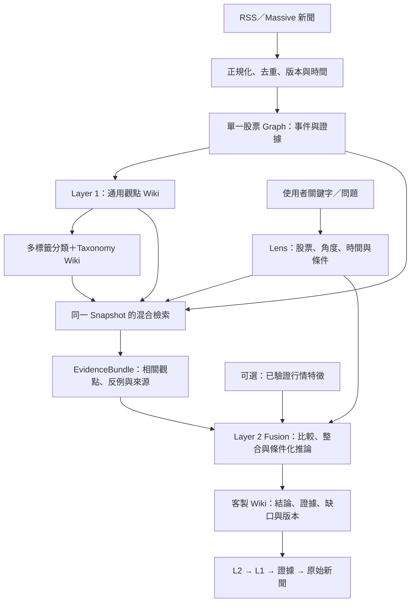

# 02｜流程、增量更新與時間邊界

## 1. 端到端流程

Classifier 是支援 Layer 1／Layer 2 的分類與索引元件；系統仍只有兩個觀點層。箭頭表示資料依賴，不表示每個方塊必須拆成獨立服務。

## 2. 流程 A：Ingest→Layer 1→分類

1. 沿用既有 ingestion adapter，保存來源識別、URL、原始可取得內容、內容 hash、發布與取得時間。RSS 只有摘要就記 `content_completeness=summary_only`，不能假裝讀過全文。
2. 依 provider article ID、正規化 URL、內容 hash 做精確去重；再以事件／轉載群組處理近似重複。同一事件不同獨立來源仍保留；不把相似文字直接刪成只剩一家報導。
3. 每個新聞版本是不可變 revision。更正、補充、撤稿都新增版本與狀態事件，保留歷史可追溯性。
4. 辨識 `instrument_id`、事件、可引用片段與報導主張。多股票新聞可分別映射至每檔 root，必須記錄相關角色，不能只因提及 ticker 就當成核心影響。
5. 找出受影響的事件與 L1 觀點；LLM 根據新證據與現有 revision 提出 create／revise／supersede／retract／no_change patch。
6. 驗證 patch 的 schema、來源引用、股票範圍、時間、語意支持與 expected revision。通過後提交 L1 revision。
7. 以本次 L1 revision 與固定 taxonomy revision 分類。LLM 提出 label assignment 與候選新詞；程式驗證後保存版本化 assignment。
8. 建立或更新相關 L1 Wiki、分類頁、membership、全文／語意索引與變更 log。索引必須對應相同 corpus／taxonomy epoch。
9. 發出持久化的 change event，讓 SavedLens 重新判定候選集合是否已改變。

L1 生成與分類可以共用一次模型呼叫以節省成本，但必須分別有可驗證的輸出契約、版本與失敗處理。分類失敗不應刪除已驗證的 L1；可暫時以 `classification_pending` 進行文字／語意檢索，並標示分類覆蓋不足。

分類補完須發布新的 assignment／candidate-set epoch，觸發相關 live Lens 重檢索。對嚴格 tag filter，尚未分類代表 unknown，不能假裝已確認不符合；結果應揭露未分類的候選範圍，且不得把它們悄悄加入嚴格匹配集合。

## 3. 流程 B：Query→Lens

### 3.1 輸入與預設

輸入可以是短詞、完整問題或 UI 篩選條件。例如：「股票動能」、「資料中心支出對短期走勢的影響」、「只看最近一個月與供應鏈風險有關的觀點」。

股票預設取目前明確選中的 Graph root。若沒有選中股票且文字也無法確定，回傳 `needs_input`。不要依近期操作猜一個不同股票。

本規格建議的初始 UI 預設：`as_of=查詢開始時間`、新聞觀察窗 30 個日曆日、展望 20 個交易日；這些都是可調產品參數，不是投資上有效的實證門檻。明確顯示預設與市場時區，並容許更改。歷史有效但在窗外的背景觀點，只有在使用者未要求嚴格時間篩選時才能作 `background_context`，不得冒充窗內新催化事件。

新聞觀察窗預設 `window_basis=published_at`，即符合 cutoff 的底層來源版本之發布時間；不能使用 L1 最近改稿時間代替新聞時間。窗採 `[start,end)`。若改用 `event_time` 或 `revision_available_at`，須明示它代表事件時間或系統取得資訊的時間；所有情況另外強制套用知識 cutoff。未知發布時間不得臆補：嚴格時間篩選排除並列缺口，非嚴格模式可當 time_unknown 背景；量化趨勢預設不計入。事件為時間區間時，檢索可按與視窗相交召回並標不確定；量化計數需另有明確規則，不能默認其發生在區間終點。

### 3.2 Lens 解析契約

分開記錄：

- `hard_filters`：owner／workspace ACL、instrument、as_of、明確 required／excluded term、使用者指定的嚴格時間與資料條件。
- `soft_preferences`：分析角度、語意主題、排序偏好、使用者表達的立場或關注點。
- `interpretations`：對模糊詞的解讀、預設與依據；`required_inputs`：價格／量／歷史 snapshot 等需求。

只輸入「動能」時，不能把 `analysis.price_momentum` 當強制 tag 過濾，導致尚未貼該標但相關的基本面事件全部被排除。先做較廣的語意路由，再由證據判斷該觀點與動能的關聯。

明確 hard filter 不能在零結果時被暗中放寬。需要建議擴大範圍時，回傳建議與當前空結果，讓下一個 query 使用新條件。

SavedLens 保存的是時間規則：live Lens 保存 `cutoff_mode=rolling_now` 與相對 lookback；每次 refresh 重新解析 cutoff／window。QueryRun 才保存本次解析出的絕對 `as_of` 與 start／end。pinned Lens 固定時間與 snapshot；不能把首次查詢的絕對時間直接寫死成 live Lens 的永久截止時間。

## 4. 流程 C：檢索與 EvidenceBundle

### 4.1 固定一個可重現 Snapshot

查詢開始時固定 `snapshot_id`，包含可見 source／event／L1 revisions、taxonomy／assignment revision、索引 epoch 與行情版本。整個檢索與 fusion 使用同一 snapshot；不能分類讀 v3、L1 讀 v4、正文讀最新。

Snapshot 必須列 `component_status` 與 `enabled_retrieval_channels`。分類 pending 時，只有明確的 degraded snapshot 可以關閉分類路徑，使用同版本文字／可用語意檢索，並回傳 partial coverage；不能把舊 revision 的分類套到新版 L1，亦不能把部分完成偽裝成完整索引。

ACL、instrument 與時間限制須在每條檢索路徑及 Graph expansion 都生效，且在交給 LLM 前再驗證一次。共享 cache 也必須含權限範圍與 snapshot，不能只用 query 字串當 key。

### 4.2 多路召回

1. 結構化路徑：canonical term／alias、明確篩選條件、觀點屬性。
2. 文字路徑：沿用現有全文檢索，涵蓋 L1 標題、命題、候選詞與必要證據文字。
3. 語意路徑：已有 embedding 時使用向量相似度；沒有時先交付文字＋分類的可用版本，揭露降級，不要求先換 DB。
4. Graph 路徑：在候選周邊有限 hops 擴展支持／反對證據、相關事件與互相衝突的觀點。第一版建議 1–2 hops，設 node／edge／token budget。

依 `opinion_id + revision_id` 去重，保留事件／轉載群組，避免同一消息洗版。分類路徑是增加召回與解釋性的方法，不是唯一入口。

### 4.3 排名與反證

可用 RRF 合併 lexical／semantic 排名，再以可解釋規則或現有 reranker 進行重排。不要直接把 BM25、cosine、LLM relevance 未校準相加；RRF 的相關度分數也不是投資信心或上漲機率。

在 token budget 內保留：不同事件、來源獨立性、相關但相反的觀點、時間變化。對每個重要主張主動搜尋已存在的反證與 contradiction edge。找不到反證只能寫「在本次已檢索範圍未找到」，不能宣稱不存在。

### 4.4 EvidenceBundle

輸出一個有上限且可檢查的 bundle，包含：

- 本次 Lens 與 snapshot manifest。
- 選中 L1 的完整相關 claims、revision、被選理由、分類及時間。
- 支持／反對證據的來源 revision、精確位置、必要文字、source／event group。
- 相關 Graph path 與關係類型，避免只給圖上距離。
- 已計算且符合 cutoff 的行情 features，或具體缺資料清單。
- 候選總量、截斷數、檢索通道、coverage、索引延遲與被排除理由。

不得只傳幾句 L1 摘要就要求 L2 生出新因果論點。若追溯發現目前 L1 漏掉重要資訊，建立上游 maintenance task；L2 在當次只標示缺口，待 L1 正式更新後重新檢索。

## 5. 流程 D：Fusion→Layer 2 Wiki

1. 以 Lens 定義的研究問題整理候選，識別支持、衝突、互補與不相關者。
2. 跨觀點合併重複敘事，但保留獨立來源數與不確定性；三個 RSS 轉載不能算三份獨立證據。
3. 將原有主張、模型新推論、使用者假設分開。新推論只能由 bundle 中的可引用前提導出，標示假設與失效條件。
4. 如有前一版本，使用可比時間窗與同一 metric 定義做 diff；沒有就寫 `baseline_unavailable`。
5. 產生結構化 L2 claims、引用、比較、缺口與結論，再渲染 Markdown。
6. 驗證所有 ID／revision 存在、scope 合法、來源未超 cutoff、計算一致、實質主張有依據。引用存在只是第一關，必須檢查來源是否支持所述主張。
7. 通過後保存不可變 QueryRun／CustomerOpinion revision；SavedLens 更新最新指標、index、log 與依賴 manifest。
8. 檢查發布時上游 epoch 是否仍匹配：不匹配則結果仍可作該 snapshot 的完整結果，但在 live Lens 標為 stale，排入下一輪更新，不能對使用者標 fresh。

L2 可以產生新的「分析關係」，例如兩個 L1 驅動因素在短期與長期有不同效果；不能生出新的未有來源事實、虛構管理層說法或自造市場數值。

## 6. 流程 E：增量更新與失效

### 6.1 必須有兩條失效路徑

**路徑一：已引用依賴變更。** L2 引用的 L1、證據、行情、taxonomy 或 Lens 版本變動，查反向 dependency 將相關 live L2 標 stale。

**路徑二：候選集合變更。** 新觀點可能從未被舊 L2 引用，但與 Lens 高度相關。新建／移除觀點、分類 membership 改動、alias／定義變更、索引更新與時間窗移動，也必須觸發重新檢索。

首版採保守且正確的方式：同股票的 corpus／taxonomy／可用 features epoch 改變，就使該股票所有受影響的 live SavedLens stale。先合併事件、去抖並批次排程，再重新檢索；不要把全文重讀與 LLM 重寫作為每個 change event 的直接副作用。後續才以 routing fingerprint／subscription 降低重算，並與保守基準比較防止漏更新。

**在新來源已入庫但 L1 尚未完成時，也不能標成 fresh。** 每股票維護 `ingest_epoch` 及 snapshot 的 `ingest_epoch_consumed`；只有該水位以前的變更均完成處理（包含明確 no-op），才前進 consumed 水位。若 jobs 亂序完成，不可用最大完成 ID 掩蓋中間缺口。來源新變更先標 pending／stale，待 active snapshot、必要投影及 Lens 更新完成後才清除 lag。

已知更正／撤回立即記錄 pending invalidation。當前查詢不得繼續將該證據作「目前有效」輸入；尚未完成 L1 重評時，可等待 job 或展示帶 source-changed／stale 標示的上次完整結果。pinned 內容保持不變，但可在內容外顯示「此來源後來已更正／撤回」通知，兩種時間觀點不得混寫。

### 6.2 變更矩陣

| 變更 | Layer 1／索引處理 | Layer 2 處理 |
|---|---|---|
| 新新聞、新事件 | 去重後更新受影響觀點、分類與 epoch | 同股票 live Lens 重檢索；不能只追既有引用 |
| 補抓舊新聞 | event time 放回歷史位置，known time 記今天 | 現在觀點可修訂；既有 as-known snapshot 不回填 |
| 原文更正／撤回 | 新 source revision，評估依賴 claims | 已引用結果 stale；重建後降級／修正結論 |
| 詞彙新增／合併／改定義 | 新 taxonomy revision；重分受影響 assignment，保留舊版 | 重新正規化 Lens 並重檢索，不覆寫歷史分類 |
| 只有翻譯／顯示名稱修正 | 若語意不變可只重繪，不必重分類 | 標示新呈現版本，避免無效 LLM 重跑 |
| 價格 bar 或調整因子更正 | 新 feature version／market epoch | 依賴該 feature 的 live 結果失效 |
| 時間前進、資料滑出視窗 | 增加 effective-time bucket 或排程事件 | 滾動窗與時間衰減重算，即使沒有新新聞 |
| 使用者改 Lens／權重 | 新 Lens revision | 新 query fingerprint，重檢索與生成 |
| 模型／prompt／retrieval policy 更新 | 記新版本，不覆寫舊成果 | 依明確 refresh policy 更新；保留比較能力 |
| 未成熟 N 日結果變成熟 | 寫入獨立 outcome 資料 | 更新評估頁；不得改寫當時預測紀錄 |

重新檢索後，如果有效 EvidenceBundle hash、Lens、時間 bucket、模型／prompt／policy 版本皆未改變，可只更新「已檢查」紀錄；不要虛增內容 revision。若摘要沒變但關鍵引用版本或實際時間範圍變了，仍須更新 provenance，不能假裝輸入相同。

## 7. 時間與 look-ahead 邊界

### 7.1 四種時間不得混用

| 欄位 | 含義 |
|---|---|
| `published_at` | 來源宣稱發布時間；未知可為 null |
| `event_time`／`event_time_range` | 報導所指事件發生時間；可能與發布不同 |
| `revision_available_at` | 本系統首次取得此一版本內容的時間；更正版本另記 |
| `committed_at` | 此版本在本系統驗證並提交可用的時間 |

article-level `first_seen_at` 只代表首次看到這篇文章，不能拿來當後來更正版本的 available time。已知時間不得因補抓資料被倒填成發布時間。

`as_of=T` 的預設模式為 `as_known`：source、L1、taxonomy 與 classification 必須在 T 以前已取得／已提交且當時有效。若那時還沒有這個 L1 版本，就不能用今天含後續資訊的 L1 代表當時看法。歷史索引、embedding、taxonomy 與 source text 也需對齊可見版本。所有 revision 類型均保存 available／committed 時間。更正／撤回等狀態另存有 known_at／committed_at 的事件，查詢以 `status_as_of(T)` 判定，不能用今天的 status 反向抹去歷史有效資料。

純數學 feature／metric 可使用 T 前已可用的輸入與 T 前已確定的固定計算定義重算，標 `derivation_mode=deterministic_recompute`，保留輸入 revision、definition version、input_available_at、computed_at 及 committed_at。這類計算可在查詢途中完成，不因 computed_at 晚於 T 就誤判為使用未來行情；但不得讀 T 後修正的 bar、調整因子或定義。已存 feature 也須能驗證上述輸入。若要求查看當時已產出的數值／答案，則只回放當時已提交的 pinned artifact，不以今天重算冒充。

需要用今天補齊的資料重建過去事件時，可另建 `reconstructed` 模式，清楚標示生成時間、較晚取得的資料與重建範圍；不能與歷史真實可知結果混在績效評估。第一版可只支援 `as_known`，無歷史版本就回傳不足。

Snapshot 之外另保存 `generated_at`；「分析截止時間」與「這份答案生成時間」不是同一件事。

今天以 `as_known` 證據新產生的 L2，是今天對當時可得資料所作的分析；不能聲稱那個答案在過去已存在。模型／prompt 版本也需記錄；嚴格重放舊結果優先讀保存的 artifact。`reconstructed` 模式則另容許明示的較晚取得證據，兩者不得混淆。

## 8. 動能資料契約

### 8.1 敘事動能

可以研究獨立事件數、來源覆蓋、主張方向的變化、新催化事件的到達與已解決／新增加的反證。若比較 `W_now=[T-30d,T)` 與 `W_prev=[T-60d,T-30d)`，需使用一致的來源與去重規則，報告缺資料天數與 coverage 變化。

API 故障恢復或一次大量補抓不能直接被解讀成敘事突然轉強。event-time 的現在重建趨勢與 ingestion-time 的系統觀測趨勢應標示清楚。沒有足夠歷史基線時可提供定性催化分析，不給偽精準的 momentum 分數。

### 8.2 價格／成交量動能

由程式在同一 cutoff 的行情上計算。可先提供最簡單、定義明確的 backward-looking N-session return：

`trailing_return_N(t) = P(t) / P(t-N) - 1`

其中 t 是 cutoff 之前最後一個已完成且資料已可用的交易 session，N 使用交易日而非日曆日。至少需要 N+1 個可比價格點。記錄市場、時區、資料來源、price basis、缺值規則與 feature definition version。調整後價格涉及後來的 corporate action 時，歷史 as-known 計算必須能取得當時可用的調整版本，否則揭露限制。

成交量、relative strength 等可以擴充，但不能把股票新聞 API 的可用性當成行情資料已接通。沒有行情時，L2 僅輸出敘事部分，`price_momentum_status=unavailable`；不由 LLM猜數字。

### 8.3 事後 N 日結果

以下是不同指標，必須分欄保存：

- `forward_return_N = P(t0+N)/P(t0)-1`：事件之後第 N 個交易日的累積報酬。
- `mean_daily_return_N = mean(P(t0+i)/P(t0+i-1)-1, i=1..N)`：之後 N 個交易日的平均單日報酬。
- `mean_cumulative_return_N = mean(P(t0+i)/P(t0)-1, i=1..N)`：之後各日相對起點報酬的平均；只有產品真的需要才計算。

`t0` 與價格取樣規則要先固定，例如「訊號可用後第一個完整交易 session 的 close-to-close 基準」，並將其限制寫進定義；不能事後挑起點。事件研究報酬不等於可成交策略收益。

未滿 N 日的 outcome 為 pending，不填 0。只可在後續研究中使用「當前 cutoff 前已完整成熟且可用」的歷史 outcome，必須可追溯；第一版不將它們送入 live fusion。任何機率估計都另需樣本、重疊事件處理、walk-forward 驗證及校準，不能由分類信心或 LLM語氣替代。

## 9. 一致性、權威資料與失敗處理

每個欄位只能有一個權威表示。優先沿用既有設計：

- 若 DB／Graph 已是權威：LLM 產生結構化 patch 與受控正文；驗證後提交，再渲染 Markdown、index、向量與圖形投影。
- 若現有 Wiki Markdown 是權威：保留之，加入可驗證 frontmatter／typed blocks、版本化提交與 schema；Graph／DB／索引由它重建。

不得讓 LLM 同時任意改 Markdown 和 DB，再期望兩份自然一致。分類定義與文本可以 LLM 維護，membership、引用、hash、版本與 index 更新由程式負責。

工作流程採具備重試的持久化狀態；可使用現有 DB job table，不強制外部 queue。建議：`queued → running → validated → committed → materialized`，失敗進 retryable 或 failed。交易提交與 change event 用同一交易或等價可恢復機制；外部索引／Wiki 投影完成後才前進對外可見 manifest。

- `idempotency_key` 由 task type、scope、source/input revisions、configuration versions 計算，不能只用文章 URL。
- 使用 expected revision／compare-and-swap 防止並行 patch 蓋掉彼此；衝突需重新讀取與產生 patch。
- 適當重試後仍失敗，保留上次成功結果並清楚標 stale／failed，不刪成空白也不標 fresh。
- 部分索引失敗時，不宣稱完整 snapshot；可回退上一個完成 snapshot並標示截止時間與 lag，或明確降級到同版本的文字檢索。
- LLM 僅有 allowlisted read／patch 契約；來源文內的指令視為資料，不允許改系統規則、讀取別人的 Lens 或開啟任意工具。
- 對 snapshot materialization、孤兒引用、分類 membership、循環依賴與 pending jobs 執行可重入 lint；lint 不能無依據修造事實。

## 10. Graph 呈現

沿用既有 Graph renderer，加入可區分型別的 L1、term、Lens／L2 節點；大量 membership 可作屬性與按需展開，避免每個 tag 拉一條永久可見線。

點選任一 L2 claim 應可向下查看 L1 revision、支持／反對的 evidence、原始 news revision。邊須有明確型別（例如 `DERIVED_FROM`、`SUPPORTED_BY`、`CONTRADICTED_BY`、`CLASSIFIED_AS`），不可把純文字相似度的 `RELATED_TO` 當成因果。

只在授權範圍內顯示 owner 的 Layer 2。L2 與其生成文章均不得被 ingestion 當成新新聞回送 L1；若要回饋共用層，必須另以外部證據通過正式 L1 maintenance。
