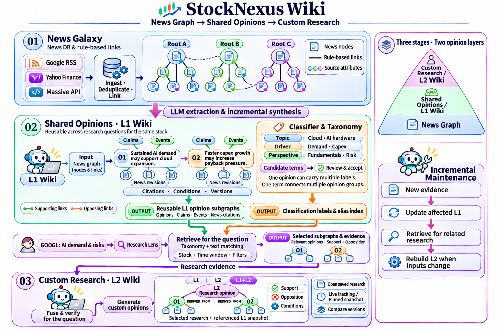

# StockNexus Wiki

[繁體中文](README.md) · **English**

Turn a flood of news into connected, traceable opinions that you can explore and maintain over time.

## What does it help you do?

- **Cut through news overload**: collect Google News RSS, Yahoo news and Massive articles, deduplicate them, and explore related events in a news graph.
- **Compare conflicting arguments**: use AI to cross-check sources and organize supporting evidence, opposing evidence and conditions into a shared opinion Wiki.
- **Build on earlier research**: L1 keeps reusable opinions, classifications and citations for each stock. New evidence updates the Wiki incrementally, with version history.
- **Investigate your own questions**: enter a research topic, retrieve relevant L1 subgraphs and evidence, and create a custom L2 research Wiki.
- **Ask about connections you discover**: select news or Wiki nodes and discuss the current context and citations with Chat Agent.

## How it works

[](docs/media/stocknexus-architecture-en.png)

1. **Explore the news**: choose a stock, dates and sources. Read articles and follow relationships in the 3D galaxy or timeline.
2. **Build the L1 Wiki**: open **LLM Wiki**, choose dates and a model, then start or continue processing. Start with the latest month if you prefer.
3. **Inspect opinions**: use classifications to find opinion groups. Select nodes to follow claims, events, supporting and opposing evidence, and original articles.
4. **Create L2 research**: open **Research · L2**, enter a question such as “How does AI demand affect cloud profitability and capital expenditure?”, choose an observation window, and create the study.
5. **Compare in one graph**: switch between **L1**, **L2** and **L1+L2**. Follow the citation chain or ask follow-up questions in the Chat Agent panel.
6. **Save and follow changes**: save a study as **live tracking** or a **pinned snapshot**, then inspect updates and compare versions.

Shared L1 opinions can serve many research questions. Classification labels and aliases help retrieve relevant opinions. L2 combines the selected opinions and counter-evidence into a new research view. With maintenance enabled, the system checks new evidence and dependencies while reusing unchanged results.

## Quick start

Install Python 3.10+, Docker Engine and Docker Compose with `up --wait` support. From the repository root, run:

```bash
./run.sh
```

Follow the prompts to choose your data location and connection mode, then open **[http://127.0.0.1:8765/](http://127.0.0.1:8765/)**.

AI features use your local Codex sign-in. Install Node.js 20+ and run the first-time setup:

```bash
./run.sh chat setup
npx --no-install codex login  # Skip if already signed in
./run.sh up
```

The model selector reads the models available to your account. Google and Yahoo search work directly; configure an API key in the source settings to use Massive.

Useful commands:

```bash
./run.sh up       # Rebuild and start after updating the code
./run.sh status   # Inspect services
./run.sh logs     # Read logs
./run.sh down     # Stop services and keep your data
```

For local Python mode, use `./run.sh local`. See the [runtime guide](spec/RUNTIME.md) for more configuration options.

## Keep your data and research

- News and Wiki data are stored in local SQLite databases by stock, including nodes, relationships, sources and revisions.
- Persistent graph caches reuse earlier work when you change display budgets, switch sources or reopen the page.
- Save a news graph snapshot, export JSON, or export Wiki Markdown.
- Use `merge_data.sh` to merge data from another computer or USB drive. Pause Wiki processing for the target stock, preview the merge, then apply it:

```bash
./merge_data.sh --from /media/usb/data --to ./data --dry-run
./merge_data.sh --from /media/usb/data --to ./data
```

Replace the paths with your actual source and destination. See [data merging and backups](spec/DATA_MERGE.md).

## Learn more

- [Wiki operation and maintenance](spec/WIKI_RUNTIME.md)
- [L1, classification and L2 research](spec/RESEARCH_LAYERS.md)
- [Chat Agent setup and usage](spec/CHAT_AGENT.md)
- [API documentation](docs/API.md)
- [Project map](spec/PROJECT_MAP.md) · [Current status](spec/CURRENT_STATE.md) · [Test records](spec/TESTING.md)
