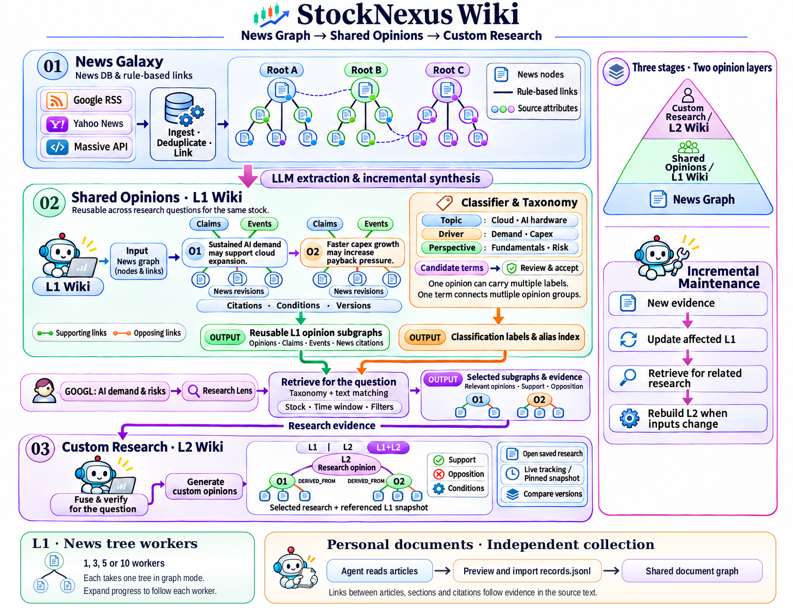

# StockNexus Wiki

[繁體中文](README.md) · **English**

Turn a flood of news into connected, traceable opinions that you can explore and maintain over time.

## Build a research graph from your own documents

Give the following prompt to an agent with access to your documents. Replace the placeholder with the folder path. If the agent works on another machine, give it the [document import skill folder](skills/stocknexus-document-import/) as well.

```text
Read skills/stocknexus-document-import/SKILL.md and follow its document record schema.
Convert <folder containing stock manuals, research notes and other mixed files> into one UTF-8 records.jsonl.
Use collection ID my_research and source ID manuals. Preserve meaningful folders, documents and sections.
Use stable IDs and parent_id for hierarchy. Keep original text, relative paths and verifiable page or heading locators.
Leave unknown dates empty. Reuse prior node IDs on updates. Deliver the importable records.jsonl
and list any skipped files with reasons. I will import it in the Web UI.
```

On the running homepage choose **Import documents**. Enter the same collection and source IDs, select `records.jsonl`, and click **匯入並開啟圖譜** (import and open graph). The graph opens with the imported source selected. **只預覽** (preview only) shows added, updated and unchanged counts. Try the [three-node example](skills/stocknexus-document-import/examples/manual.jsonl). Web uploads accept files up to 32 MiB. Larger exports can use the CLI workflow below.

## What does it help you do?

- **Cut through news overload**: collect Google News RSS, Yahoo news and Massive articles, deduplicate them, and explore related events in a news graph.
- **Compare conflicting arguments**: use AI to cross-check sources and organize supporting evidence, opposing evidence and conditions into a shared opinion Wiki.
- **Build on earlier research**: L1 keeps reusable opinions, classifications and citations for each stock. New evidence updates the Wiki incrementally, with version history.
- **Investigate your own questions**: enter a research topic, retrieve relevant L1 subgraphs and evidence, and create a custom L2 research Wiki.
- **Ask about connections you discover**: select news or Wiki nodes and discuss the current context and citations with Chat Agent.

## How it works

[](docs/media/stocknexus-architecture-en.png)

1. **Explore the news**: choose a stock, dates and sources. Read articles and follow relationships in the 3D galaxy or timeline.
2. **Build the L1 Wiki**: open **LLM Wiki**, choose dates and a model, then start or continue processing. Start with the latest month if you prefer.
3. **Inspect opinions**: use classifications to find opinion groups. Select nodes to follow claims, events, supporting and opposing evidence, and original articles.
4. **Create L2 research**: open **Research · L2**, enter a question such as “How does AI demand affect cloud profitability and capital expenditure?”, choose an observation window, and create the study.
5. **Compare in one graph**: switch between **L1**, **L2** and **L1+L2**. Follow the citation chain or ask follow-up questions in the Chat Agent panel.
6. **Save and follow changes**: save a study as **live tracking** or a **pinned snapshot**, then inspect updates and compare versions.

Shared L1 opinions can serve many research questions. Classification labels and aliases help retrieve relevant opinions. L2 combines the selected opinions and counter-evidence into a new research view. With maintenance enabled, the system checks new evidence and dependencies while reusing unchanged results.

## Quick start

Install Python 3.10+, Docker Engine and Docker Compose with `up --wait` support. From the repository root, run:

```bash
./run.sh
```

Follow the prompts to choose your data location and connection mode, then open **[http://127.0.0.1:8765/](http://127.0.0.1:8765/)**.

AI features use your local Codex sign-in. Install Node.js 20+ and run the first-time setup:

```bash
./run.sh chat setup
npx --no-install codex login  # Skip if already signed in
./run.sh up
```

The model selector reads the models available to your account. Google and Yahoo search work directly; configure an API key in the source settings to use Massive.

Useful commands:

```bash
./run.sh up       # Rebuild and start after updating the code
./run.sh status   # Inspect services
./run.sh logs     # Read logs
./run.sh down     # Stop services and keep your data
```

For local Python mode, use `./run.sh local`. See the [runtime guide](spec/RUNTIME.md) for more configuration options.

## Keep your data and research

- News and Wiki data are stored in local SQLite databases by stock, including nodes, relationships, sources and revisions.
- Persistent graph caches reuse earlier work when you change display budgets, switch sources or reopen the page.
- Save a news graph snapshot, export JSON, or export Wiki Markdown.

### Import from another directory

Choose your source and pause Wiki processing for the target stocks. This example imports all of `../incoming/data` into `./data`. For a single stock, use `../incoming/data/graph/GOOGL` (news graph) or `../incoming/data/llm_wiki/GOOGL` (Wiki) as the source in both steps.

1. **Preview the merge.** Adding `--dry-run` shows the planned changes without writing to the destination database.

   ```bash
   ./merge_data.sh --from ../incoming/data --to ./data --dry-run
   ```

2. **Apply the merge.** After checking the preview, keep the same source and destination, remove `--dry-run`, and run the command again to write the changes.

   ```bash
   ./merge_data.sh --from ../incoming/data --to ./data
   ```

See [data merging and backups](spec/DATA_MERGE.md) for more examples.

## Import your own document graph

Give your independent agent the [document import skill](skills/stocknexus-document-import/SKILL.md) and a folder. Ask for UTF-8 JSONL with stable IDs, hierarchy and original locators. Transfer the result to the web server host and run from the project root:

```bash
# Preview only
python3 scripts/import_documents.py --collection my_research --source manuals --input records.jsonl --dry-run
# Remove --dry-run to apply
python3 scripts/import_documents.py --collection my_research --source manuals --input records.jsonl
```

Choose the collection and check its source beneath Massive on the homepage. Open multiple sources together in the document graph. Use the same `--data-dir` on both commands if the service mounts a different host directory. Undated documents and agent-authored L1/L2 claims are supported.

## Learn more

- [Wiki operation and maintenance](spec/WIKI_RUNTIME.md)
- [L1, classification and L2 research](spec/RESEARCH_LAYERS.md)
- [Chat Agent setup and usage](spec/CHAT_AGENT.md)
- [API documentation](docs/API.md)
- [Project map](spec/PROJECT_MAP.md) · [Current status](spec/CURRENT_STATE.md) · [Test records](spec/TESTING.md)
