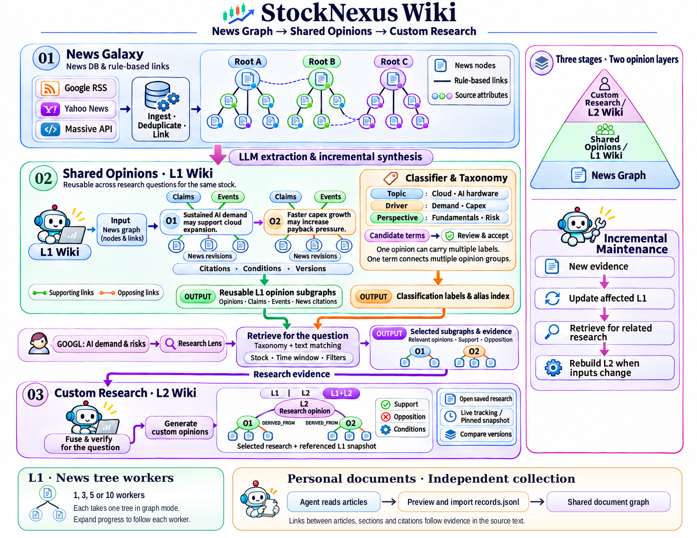

<p align="right"><strong>English</strong> · <a href="README.zh-TW.md" lang="zh-Hant">繁體中文</a></p>

# StockNexus Wiki

A single earnings report can generate dozens of headlines. Some repeat the same announcement. Others draw conflicting conclusions from the same numbers. StockNexus Wiki helps you clean up a noisy stock news feed, see what each source adds, and trace a research conclusion back to the articles behind it.

## What does it help you do?

- **Cut through news overload.** Collect articles from Google News RSS, Yahoo News and Massive, remove duplicates, and explore related coverage together in the news graph.
- **Compare conflicting arguments.** Use AI to compare sources and organize the evidence for and against a claim, along with the conditions under which it holds.
- **Build on earlier research.** The shared Wiki (L1) keeps viewpoints, classifications and citations for each stock. Incremental updates preserve earlier revisions so you can see what changed.
- **Investigate your own questions.** A custom study (L2) draws on the relevant parts of the L1 graph. You can ask how AI demand affects margins and reuse the same evidence for a separate question about capital spending.
- **Ask about connections you discover.** Select an article or a Wiki viewpoint and ask the Chat Agent to explain the connection using the current selection and its citations.

[](docs/media/stocknexus-architecture-en.png)

## Quick start

From the repository root, run the launcher with Python 3.10+, Docker Engine and Docker Compose with `up --wait` support.

```bash
./run.sh
```

Choose a data directory and connection mode, then open the [local workbench](http://127.0.0.1:8765/). Google News RSS and regional Yahoo coverage via Google RSS are available immediately. For Massive, enter an API key in the source settings.

For AI-assisted Wiki and Chat, install Node.js 20+ and use your local Codex account. Skip the login command if you are already signed in.

```bash
./run.sh chat setup
npx --no-install codex login
./run.sh up
```

## Research a stock

1. **Explore the news.** Choose a stock and date range. Open a story in the 3D graph or timeline to inspect the rule behind a connection and read the original source.
2. **Build shared viewpoints (L1).** Open **LLM Wiki** for that stock and select **Start processing**. Each viewpoint keeps its citations and revision history. In graph mode, 1, 3, 5 or 10 workers can take different news trees. Expand progress to see which tree each worker is processing.
3. **Inspect a viewpoint.** Use the category filter to find a group of viewpoints. Open a node to see its claims, events and citations, then read the articles that support or challenge it.
4. **Ask a research question (L2).** Open **Research question · L2** and ask, for example, “Which reports support or challenge the claim that data-center demand is improving margins?” L2 retrieves relevant L1 viewpoints and evidence for the selected period.
5. **Compare the layers.** Switch between **L1**, **L2** and **L1+L2**. Follow a conclusion back to its shared viewpoints and sources, or ask a follow-up in the Chat Agent panel.
6. **Save and follow changes.** Choose **Pinned snapshot** to preserve the study as it stands, or **Track updates** to follow changes in its evidence and compare versions.

## Keep your data and research

- News and Wiki data are stored locally in SQLite by stock, including sources, relationships and revision history.
- The news graph cache lets you reuse earlier work when you change the display limit, switch sources or reopen the page.
- Save a news graph snapshot to return to an exploration, export the graph as JSON, or share the Wiki as Markdown. Saved Chat Agent conversations can also be reopened.

## Import your own documents

Give your agent the [import skill folder](skills/stocknexus-document-import/) and your articles, then ask it to prepare the import.

```text
Read stocknexus-document-import/SKILL.md and process <path to an article or folder>.
```

The agent returns a validated `records.jsonl` with article sections and links grounded in the text. Missing titles fall back to the filename stem. Unknown dates can be omitted.

Open **Import research documents** on the homepage and select your JSONL file. The upload form currently uses Traditional Chinese. Of the two buttons below the file picker, the second previews how many records will be added or updated. After reviewing the counts, use the first button to import the file and open the graph.

Each collection has its own graph of articles, sections and citations, stored separately from the stock Wiki. [Try a sample JSONL](skills/stocknexus-document-import/examples/manual.jsonl) · [Import guide](spec/DOCUMENT_IMPORT.md)

## Reference

[Startup and service commands](spec/RUNTIME.md) · [Data migration and backups](spec/DATA_MERGE.md) · [Wiki and research layers](spec/RESEARCH_LAYERS.md) · [API](docs/API.md) · [Project map](spec/PROJECT_MAP.md)
