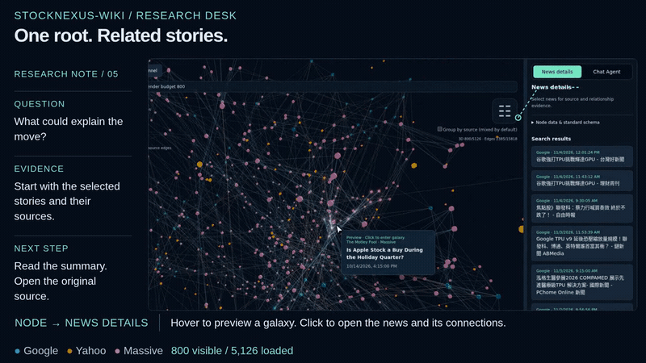

# StockNexus-Wiki

以真實財經新聞建立可解釋的關聯圖譜，結合 **3D 探索、時間軸與持久快取**。
GitHub 儲存庫：[a0665x/StockNexus-Wiki](https://github.com/a0665x/StockNexus-Wiki)。

## 影片 C：研究流程示範（Research Desk）

從財報或產品分類縮小範圍，在 3D 圖譜中選取新聞、展開關聯，再用圖內搜尋與 Chat Agent 整理下一個值得查證的問題。

[](docs/media/research-demo.mp4)

[觀看完整研究版影片（約 62 秒，MP4）](docs/media/research-demo.mp4)。上方為 7 秒循環預覽；完整影片涵蓋財報分類、3D 探索、圖內搜尋與示意對話。

影片中的 Chat Agent 對話標示為 **illustrative dialogue**，展示提問流程，不是即時模型輸出或已驗證的市場結論。影片錄製於較早的介面版本；最新版本另加入視圖優先計算、分開進度與 650ms 停留說明。

已完成的視圖可直接重用；切換範圍時，後端會重用配對評分快取並只補算缺少的配對。快照保存既有連線與最多 12 組近期完成視圖。

## 目前實作狀態

| 項目 | 狀態 |
| --- | --- |
| News Graph、3D／時間軸、來源與分類篩選 | 已實作 |
| 視圖優先關聯、閒置補線、650ms 說明 | 已實作；預設 800、最多 2,400 節點 |
| Contextual Chat Agent | 已實作；需啟動本機橋接並登入 Codex |
| Temporal LLM Wiki | 已實作獨立股票 DB、LLM 增量抽取／關聯提案、版本與 Wiki Graph；依賴重評／回測尚未實作 |

從頂部 **LLM Wiki** 切換：選股票與全局查詢／日期範圍 → 預覽 → 確認整理。可明確開啟持續維護，讓背景檢查指定查詢在新聞 DB 的新內容；不另行抓新聞。每股 Wiki 使用獨立 SQLite 保存節點、連線、引用與版本，重新開頁不用重算。模型選單讀取 Codex 實際目錄，預設 `gpt-6.1-sol`。可先處理最近一個月再擴大，跨模型重用已完成文章；主頁節點預算與 edge 設定不觸發 Wiki 重算。局部校正另行手動啟動並受配額限制。操作、配額與部署見 [Wiki 使用與維護](spec/WIKI_RUNTIME.md)，完整研究範圍見 [設計](spec/TEMPORAL_WIKI.md)。

## 功能

- 整合 Google News RSS、Yahoo 地區新聞與 Massive；支援日期範圍、來源與分類篩選。
- 每條關聯保留共同實體、主題或標題相似度的證據。
- 新聞自動存入 SQLite；相同資料與規則可重用持久圖譜快取。
- 支援圖譜快照、JSON 匯出、繁體中文／英文介面及 REST API。
- 3D 預設顯示 800 節點，可調至 2,400；先計算目前視圖的嚴格關聯，自適應補線在閒置時啟動，操作期間延後套用結果。
- 節點、關聯計算、連線渲染與狀態分開顯示；滑鼠在標籤上靜止 650ms 顯示解釋，鍵盤聚焦也可查看。
- 預算外新聞保留於清單、時間軸與匯出，進入視圖時才補算關聯；匯出及快照明示局部關聯範圍。

## 快速啟動

下載專案後，在專案根目錄執行。需要 Python 3.10+、Docker Engine 與 Docker Compose（支援 `up --wait`）。

```bash
./run.sh
```

依提示選擇資料位置與連線方式，完成後開啟 [本機網頁](http://127.0.0.1:8765/)。

```bash
./run.sh up       # 更新程式後重新建置與啟動
./run.sh status   # 查看服務狀態
./run.sh logs     # 查看日誌
./run.sh down     # 停止服務，保留資料
```

不使用 Docker：執行 `./run.sh local` 或 `python3 server.py`。後端使用 Python 標準函式庫，前端不需 npm/build；3D 需要瀏覽器支援 WebGL。

## 使用方式

1. 輸入關鍵字、來源及日期，按「搜尋新聞」。Massive 另需股票代碼與 API key；Google／Yahoo 不需 key。
2. 在 3D 或時間軸探索新聞；圖內搜尋只查已載入的文章。
3. 在「關聯設定」調整規則並按「套用」。成功後，同瀏覽器、同網址會沿用設定。
4. 用「儲存圖譜快照」保留當時的資料與規則；載入快照不等於重新搜尋最新新聞。

「Already in DB」表示文章已存在；關聯另有快取。命中時可先顯示既有關聯，再補抓來源。瀏覽器的新計算以目前視圖為範圍；「目前視圖完成」不代表全部新聞的關聯都已計算。

## 文件

- [Temporal LLM Wiki 設計](spec/TEMPORAL_WIKI.md)：單股版本圖、結構化證據與研究契約；已實作範圍另見 [Wiki runtime](spec/WIKI_RUNTIME.md)，回測仍為規劃。
- [專案地圖](spec/PROJECT_MAP.md)：程式架構與文件入口。
- [標準工作流程](spec/WORKFLOWS.md)：搜尋、設定、快照、更新及驗收。
- [啟動與資料管理](spec/RUNTIME.md)：Docker、本機模式、Tailscale、搬移與備份。
- [效能與 WebGL 排錯](spec/references/lesson-20261102-rendering-cache-settings.md)：已驗證原因、修正與注意事項。
- [API 文件](docs/API.md)／[本機 Swagger](http://127.0.0.1:8765/docs)。

新聞來源不保證完整歷史，程式未抓取新聞全文；關聯分數不是因果、機率或投資建議。服務適用於本機或受信任網路，目前沒有帳號隔離。

### Chat Agent

右側可切換新聞詳情與 Chat Agent，討論目前選取的新聞並操作視圖／滑塊。
主機需 Node.js 20+、已登入 Codex；執行 `npm ci` 後以 `./run.sh chat start` 啟動。
僅開放本機 8765 網頁；沿用登入，不需在網頁填 key。新聞內容會送交登入帳戶使用的模型。
[操作與資料範圍](spec/CHAT_AGENT.md)。

首次使用 Chat Agent：在專案目錄執行 `./run.sh chat setup`，需要登入時執行 `npx --no-install codex login`，再 `./run.sh up`。使用 8765 網頁右側 Chat Agent 分頁；`./run.sh --help` 提供完整指引。`node server.mjs --open` 是另開 3210 的獨立對話範例，沒有新聞畫面上下文。

本機離線搜尋：`./run.sh local --offline`；Docker 可用 `NEWS_ATLAS_CACHE_ONLY=1 ./run.sh up`。此模式即使勾選強制更新也只讀 DB，不自動補抓缺口。已下載的日線股價可用 `python3 scripts/read_prices.py NVDA` 離線匯出 CSV。

### 開著網頁合併另一台電腦／USB 的資料

`./run.sh up` 成功後會印出對應實際資料位置的指令；另開終端執行即可。來源可指定 `data`、`graph`、`llm_wiki` 或單股目錄：

```bash
./merge_data.sh --from /media/usb/data --to ./data --dry-run
./merge_data.sh --from /media/usb/data --to ./data
```

把來源換成實際 USB 路徑，目標以啟動器印出的路徑為準。Web UI 可保持開啟；先暫停欲合併股票的 Wiki 工作／持續維護。合併後 Wiki 下拉選單約 6 秒內出現新增股票；不自動更換目前選取或啟動模型。

工具自動備份、去重，保留本地資料與來源衝突副本；不搬金鑰、不呼叫 LLM。衝突、備份、僅新聞匯入與復原詳見 [合併說明](spec/DATA_MERGE.md)。

資料布局：新聞圖 `data/graph/<ticker>/`、Wiki `data/llm_wiki/<ticker>/`；無法確認歸屬保留於 `graph/_unassigned/`。舊主 DB 在啟動時備份並遷移，見 [儲存說明](spec/GRAPH_STORAGE.md)。

目前完整功能與計算方法見 [專案現況](spec/CURRENT_STATE.md) 及 [計算定義](spec/CALCULATION_METHODS.md)；AI 協作前先讀 [修改偏好](spec/ai-dev-experience-preferences.md)。
