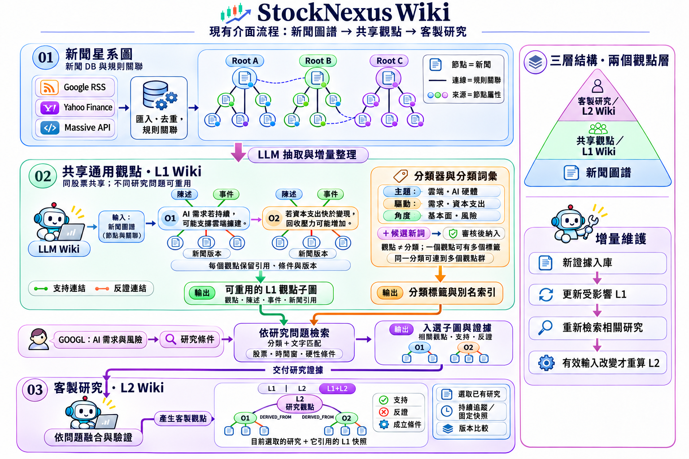

# StockNexus Wiki

**繁體中文** · [English](README.en.md)

把大量新聞整理成可探索、可追溯、持續維護的觀點。

## 解決什麼問題？

- **新聞太多、噪音太多**：整合 Google News RSS、Yahoo 新聞與 Massive，去重後在新聞圖譜中探索相關事件。
- **報導分散，論點互相矛盾**：由 AI 交互比對來源，整理支持、反對與成立條件，建立共享觀點 Wiki。
- **每次研究都要從頭讀**：L1 保留同股票的通用觀點、分類與引用，新資料進來時增量維護並累積版本。
- **想深入自己的研究問題**：輸入議題，重用相關 L1 子圖與證據，建立專屬的 L2 研究觀點。
- **看到新聞關聯，想接著追問**：選取新聞或 Wiki 節點，讓 Chat Agent 根據目前畫面與引用延伸討論。

## 工作流程

[](docs/media/stocknexus-architecture-zh-TW.png)

1. **探索新聞**：選擇股票、日期與來源，在 3D 星系圖或時間軸閱讀新聞、展開關聯。
2. **建立 L1 Wiki**：進入「LLM Wiki」，選日期與模型，按「開始／繼續整理」。可以先從最近一個月開始。
3. **理解觀點**：透過分類找出觀點群，點選節點查看陳述、事件、支持／反對證據及原始新聞。
4. **提出 L2 研究**：開啟「研究問題 · L2」，輸入例如「AI 需求對雲端獲利與資本支出的影響」，選擇觀察期間並建立研究。
5. **在同一張圖比較**：切換 L1、L2 或 L1+L2，沿著來源鏈理解研究結論；也可在右側 Chat Agent 追問。
6. **保存與持續追蹤**：將研究保存為「持續追蹤」或「固定快照」，查看更新與版本差異。

共享 L1 可供不同研究問題重用；分類與別名協助找出相關觀點。L2 融合選中的觀點與反證，新增研究論述。啟用持續維護後，系統檢查新證據與相依變化，重用未變的成果。

## 快速啟動

準備 Python 3.10+、Docker Engine 與 Docker Compose（支援 `up --wait`），在專案根目錄執行：

```bash
./run.sh
```

依提示選擇資料位置與連線方式，開啟 **[http://127.0.0.1:8765/](http://127.0.0.1:8765/)**。

AI 功能使用本機 Codex 登入。準備 Node.js 20+，首次設定：

```bash
./run.sh chat setup
npx --no-install codex login  # 已登入可略過
./run.sh up
```

模型選單讀取目前帳戶可用模型。Google／Yahoo 搜尋可直接使用；Massive 在來源設定填入 API key。

常用指令：

```bash
./run.sh up       # 更新程式後重新建置與啟動
./run.sh status   # 查看服務
./run.sh logs     # 查看日誌
./run.sh down     # 停止服務並保留資料
```

本機 Python 模式可用 `./run.sh local`；完整設定見 [啟動說明](spec/RUNTIME.md)。

## 資料與工作延續

- 新聞與 Wiki 依股票存入本機 SQLite，保留節點、連線、來源與版本。
- 新聞圖譜使用持久快取；調整顯示數量、切換來源或重開頁面可重用既有成果。
- 用「儲存圖譜快照」保存新聞探索畫面，或匯出 JSON／Wiki Markdown。
- 跨電腦或 USB 搬移資料可使用 `merge_data.sh`；先暫停目標股票的 Wiki 整理，再預覽並合併：

```bash
./merge_data.sh --from /media/usb/data --to ./data --dry-run
./merge_data.sh --from /media/usb/data --to ./data
```

來源、目標改成實際路徑；詳見 [資料合併與備份](spec/DATA_MERGE.md)。

## 深入了解

- [Wiki 使用與維護](spec/WIKI_RUNTIME.md)
- [L1、分類、L2 研究流程](spec/RESEARCH_LAYERS.md)
- [Chat Agent 設定與操作](spec/CHAT_AGENT.md)
- [API 文件](docs/API.md)
- [專案地圖](spec/PROJECT_MAP.md) · [目前狀態](spec/CURRENT_STATE.md) · [測試紀錄](spec/TESTING.md)
