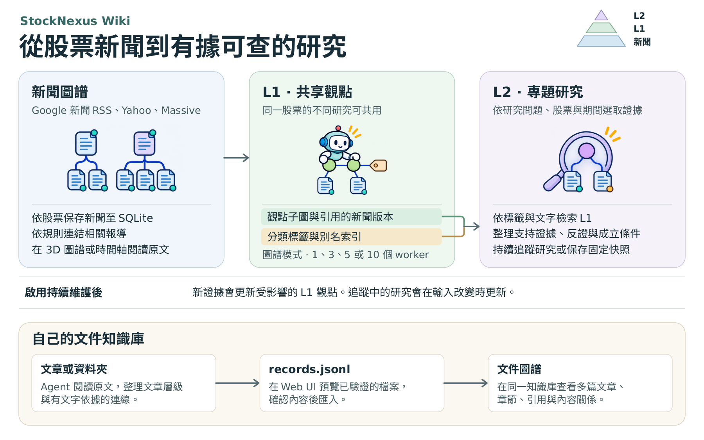

<p align="right"><a href="README.md" lang="en">English</a> · <strong>繁體中文</strong></p>

# 

一家公司公布財報後，同一份數字可能變成幾十則標題。有些報導只是轉述同一份公告，有些卻對毛利或需求得出相反的解讀。StockNexus Wiki 幫你清理股票新聞裡的雜訊，去除重複報導、把相關新聞放在一起，再沿著引用查清楚每個觀點的依據。

## 解決什麼問題？

- **新聞太多、噪音太多。** 彙整 Google 新聞 RSS、Yahoo 新聞與 Massive 的報導，去重後在圖譜中查看同一事件有哪些來源報導。
- **報導分散，論點互相矛盾。** 讓 AI 交叉比對來源，整理哪些證據支持一個說法、哪些提出反證，以及這個說法在什麼條件下成立。
- **每次研究都要從頭讀。** 共享 Wiki（L1）依股票保留觀點、分類與引用。新證據進來時增量更新，之後仍能回看觀點怎麼改變。
- **想深入自己的研究問題。** 專題研究（L2）會取用相關的 L1 觀點與證據。例如先問「AI 需求是否改善毛利？」，之後追查資本支出時，也能沿用同一批證據。
- **看到新聞關聯，想接著追問。** 選取一篇新聞或一個 Wiki 觀點，就能請 Chat Agent 根據目前選取的內容和引用，說明這些報導為什麼有關。

[](docs/media/stocknexus-architecture-zh-TW.png)

## 快速啟動

準備 Python 3.10+、Docker Engine，以及支援 `up --wait` 的 Docker Compose。從專案根目錄啟動工作台。

```bash
./run.sh
```

依提示選擇資料目錄和連線方式，再開啟[本機工作台](http://127.0.0.1:8765/)。Google 新聞 RSS 和透過 Google RSS 取得的 Yahoo 地區新聞可直接搜尋。使用 Massive 時，在來源設定填入 API key。

要用 AI 整理 Wiki 或使用 Chat，請安裝 Node.js 20+ 並使用本機 Codex 帳號。已登入可略過第二行。

```bash
./run.sh chat setup
npx --no-install codex login
./run.sh up
```

## 研究一檔股票

1. **探索新聞。** 選擇股票與日期範圍，在 3D 圖譜或時間軸點開報導，就能查看連線依據與新聞原文。
2. **整理共享觀點（L1）。** 開啟同一檔股票的 **LLM Wiki**，按「開始整理」。每個觀點保留引用及修訂紀錄。圖譜模式可用 1、3、5 或 10 個 worker 分領不同新聞樹，展開進度就能查看各自正在處理哪一棵。
3. **檢查觀點。** 用分類篩選找出觀點群，點開節點查看陳述、事件與引用，再回到支持或反駁這個觀點的新聞原文。
4. **建立專題研究（L2）。** 開啟「研究問題 · L2」，例如問「哪些報導支持或反駁『資料中心需求正在改善利潤率』的說法？」系統會從指定期間的 L1 觀點與證據整理答案。
5. **在同一張圖比較。** 切換 L1、L2 或 L1+L2，從研究結論沿著引用回到共享觀點與原始報導，也可以在右側 Chat Agent 繼續追問。
6. **保存與持續追蹤。** 選「固定快照」保留當次研究，或選「持續追蹤」跟進後續證據，查看不同版本之間的變化。

## 資料與工作延續

- 新聞與 Wiki 依股票存入本機 SQLite，保留來源、關聯與修訂紀錄。
- 調整顯示數量、切換來源或重開頁面時，新聞圖譜可從快取載入先前的結果。
- 可儲存新聞圖譜快照、匯出圖譜 JSON，或將 Wiki 匯出成 Markdown 分享。已儲存的 Chat Agent 對話也能重新開啟。

## 匯入自己的文件

把[文件匯入 skill 資料夾](skills/stocknexus-document-import/) 和文章交給 agent，再交代要處理的路徑。

```text
請讀取 stocknexus-document-import/SKILL.md，處理「文章或資料夾路徑」。
```

Agent 會整理章節、依內文建立連線，並產出已驗證的 `records.jsonl`。沒有標題時採用不含副檔名的檔名，未知日期可省略。

在首頁選「匯入研究文件」，選檔後先按「只預覽」，確認後再按「匯入並開啟圖譜」。同一知識庫的文章、章節與引用共用一張圖，和股票 Wiki 分開保存。[試用 JSONL 範例](skills/stocknexus-document-import/examples/manual.jsonl) · [匯入指南](spec/DOCUMENT_IMPORT.md)

## 延伸文件

[啟動與服務指令](spec/RUNTIME.md) · [資料合併與備份](spec/DATA_MERGE.md) · [Wiki 與研究層](spec/RESEARCH_LAYERS.md) · [API](docs/API.md) · [專案地圖](spec/PROJECT_MAP.md)
