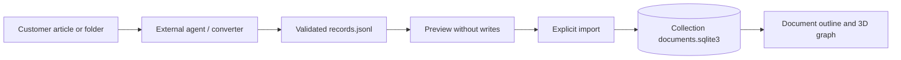

# Document collections and graph import

Entry: [PROJECT_MAP](PROJECT_MAP.md). Source baseline: `llm_wiki` at `228f6a7`, checked on 2026-11-20 (Asia/Taipei). Current runtime and verification evidence belong in [CURRENT_STATE](CURRENT_STATE.md) and [TESTING](TESTING.md).

Working-tree follow-up on the same date adds optional link rationales, a blank-filename label fallback and the missing-metadata/content-link acceptance cases below. These changes are not yet committed or deployed.

## Purpose and boundary

Customers can turn their own articles, manuals, notes or folders into a versioned document graph without a stock ticker or publication date. An independent agent prepares a validated UTF-8 `records.jsonl`; the application imports and displays that export.

This is a separate collection workspace at `/documents`. It does not feed uploaded documents into the stock Wiki compiler, automatically generate opinions, or start L1/L2 jobs. Agent-authored L1/L2 claims can be imported and filtered here, but they remain document records, not stock Wiki jobs or research runs. No model sign-in or API key is required for importing and browsing a prepared file.



## User journey

1. Give the agent the complete [document import skill folder](../skills/stocknexus-document-import/SKILL.md) and one file or a folder. A path is sufficient; defaults are collection `my_research` and source `manuals`.
2. The bundled converter handles UTF-8 `.md` and `.txt`, preserving folder and heading ancestry. PDF, Word, HTML, CSV and OCR need external extraction into the same record contract. The web form accepts JSONL, not these raw formats. The agent must report unreadable or skipped files.
3. Validate the final export with the bundled validator. For updates or references to existing records, also preview against the actual target collection.
4. Open **Import research documents** on the homepage or go to `/documents`. Select `records.jsonl`. The form uses Traditional Chinese. The second button below the file picker previews the changes. The first imports the file and opens the graph.
5. Select a collection and one or more sources. Browse the hierarchy or click a graph node for original text, location and citations. Use the layer filter for documents, L1 or L2. A revision-pinned citation opens the saved historical text even after its target changes.

If 3D is unavailable, browse the document outline.

## Multiple articles, missing metadata and graph distance

A collection contains multiple document trees in one graph. Sources can be enabled together. Each document is a node; headings become section nodes linked by containment. An unsectioned article remains one document node with its original body. Articles with no supported links remain visible as disconnected nodes or components.

The converter uses the filename stem as the display title, falling back to `Untitled document` if the stem is blank. Original article titles and dates are not required. The exported record still needs a non-empty `title`; the agent fills that label before validation. Duplicate titles are allowed because identity comes from source/ID, not title or date. When the publication date is missing or null, the details panel marks it as unknown.

The user confirmed that the skill should read content and produce supported cross-article links. The deterministic converter supplies hierarchy only. The agent then identifies concrete shared subjects, citations, supporting/opposing statements or documented revisions, and emits explicit `links` with a short `rationale`. The portable skill owns the relation-selection rules and missing-metadata workflow. Relationship validity and JSONL compatibility can be tested structurally; the factual quality of an agent's reasoning still requires checking against the actual source text.

The Web UI uses the bundled renderer's D3 force layout (link, charge and center forces) and passes node IDs and explicit edges. It does not compute embeddings, title similarity, chronological separation or weighted semantic distances. Edge types affect labels/colors, not a configured semantic length. Nearby nodes are not necessarily similar, and connected nodes have no fixed pixel separation. Source/layer filtering rebuilds the visible graph, so layout may move. Coordinates are not part of the persisted document contract.

Click a node to read its link reasons and follow targets. The page labels the layout meaning. Existing links without reasons remain valid; newly agent-authored content links should explain their textual basis. The optional `rationale` field is a non-empty string of up to 2000 characters, saved with the record revision and rendered as literal text. It requires the updated server schema; older importers reject unknown fields, so validate against the target version before handoff.

## Ownership and persistence

| Concern | Owner / contract |
| --- | --- |
| Record validation | [document_records.py](../skills/stocknexus-document-import/scripts/document_records.py), shared by the server and portable agent bundle |
| File conversion and deliverable validation | [convert_folder.py](../skills/stocknexus-document-import/scripts/convert_folder.py), [validate_export.py](../skills/stocknexus-document-import/scripts/validate_export.py) |
| Import, revisions, catalog and reads | [news_atlas/documents.py](../news_atlas/documents.py) |
| HTTP routing and assets | [server.py](../server.py), [dist/documents.html](../dist/documents.html), [dist/documents.js](../dist/documents.js) |
| CLI / explicit data directory | [scripts/import_documents.py](../scripts/import_documents.py) |
| API schema | [news_atlas/openapi.py](../news_atlas/openapi.py), also served at `/openapi.json` |

Storage is `<data-root>/graph/<collection>/documents.sqlite3`, with normalized import archives at `<data-root>/graph/<collection>/imports/<source>/<sha256>.jsonl`. It is separate from stock `news-atlas.sqlite3` and `llm_wiki/<ticker>/wiki.sqlite3`.

- Identity is collection + source + stable node ID. Identical content is unchanged; changed content appends a revision. Older revisions remain readable. Omitting a node from a later batch does not delete it.
- Kinds: `folder`, `document`, `section`, `note`, `claim`. Parent IDs describe containment within a source. Explicit links are `cites`, `supports`, `contradicts`, `updates`, `related`; cross-source links stay within the collection.
- Claims require `L1` or `L2` and at least one citation pinned to a revision; L2 also requires a research question. These checks establish structural validity, not factual correctness.
- Unknown dates remain absent/null. Paths are relative locators, not filesystem upload destinations. Original files stay with the user; JSONL stores the extracted content and locations.
- Missing parents, cycles, conflicting duplicate IDs, invalid paths and unresolved link revisions are rejected. Preview makes no persistent document writes. Accepted revisions are committed in one SQLite transaction.
- Reuse IDs across updates. Moving a file or renaming headings can change converter-generated IDs; reconcile them with the previous export if identity must remain stable.

## HTTP and CLI

`GET /api/documents` lists collections and source counts. Add `collection` and optional `source` for current nodes. A historical lookup requires all of `collection`, `source`, `id`, `revision`. Missing collections/revisions return 404.

`POST /api/documents/import?collection=my_research&source=manuals&mode=preview` accepts the raw JSONL body with `Content-Type: application/x-ndjson`. Change mode to `apply` to write. Reports include `added`, `updated`, `unchanged`, `duplicate_lines` and `undated`. The web limit is 32 MiB; oversized bodies return 413. Both document reads and writes use the existing allowed-host/same-origin guard.

From the repository root, against the same data directory as the server:

```bash
python3 scripts/import_documents.py --collection my_research --source manuals --input records.jsonl --data-dir /path/to/server-data --dry-run
python3 scripts/import_documents.py --collection my_research --source manuals --input records.jsonl --data-dir /path/to/server-data
```

The CLI is the route for larger exports. Reimporting JSONL into the chosen target is the supported document transfer workflow; the stock DB merge workflow is a separate contract in [DATA_MERGE](DATA_MERGE.md).

## Local readiness and acceptance

Python 3.10+ and the standard library are sufficient for this backend. Frontend assets are served directly; no npm build is needed for the document page. Docker includes the shared record schema in its image, so updating the checkout alone does not update a running container. Use `./run.sh up` to rebuild when ready to update the service; `restart` alone does not rebuild. Account for any active Wiki work before replacing the runtime; see [RUNTIME](RUNTIME.md).

The acceptance scenario is: a user previews a valid export without writing, imports it, reads its hierarchy/graph, retries without duplicates, updates a source, follows an old revision citation, filters sources/layers and reloads without losing persisted data. Invalid input must leave accepted records intact.

Run `python3 -m unittest discover -s tests -p test_document_import.py -v` for conversion, validation and storage boundaries. Run `/usr/bin/python3 tests/browser_documents.py` for the real HTTP/Chromium journey using temporary data. The latter needs Chromium and the existing `websocket-client` test dependency. It does not start a Wiki worker or use production data. See [TESTING](TESTING.md) for the actual results and unverified cases.
