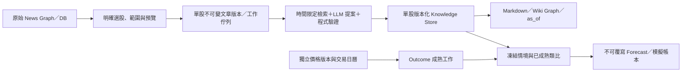

# 單股 Temporal LLM Wiki：設計入口

入口：[PROJECT_MAP.md](PROJECT_MAP.md)。狀態：**2026-11-05 已實作增量知識 runtime：獨立 DB、compiler、Wiki UI、API 與版本；完整依賴重評／預測回測仍為設計**。分支 `llm_wiki`。實際可用流程、限制與測試以 [WIKI_RUNTIME.md](WIKI_RUNTIME.md) 為準；下文保留完整研究設計，不代表所有階段均已交付。

- [診斷與抽樣證據](references/temporal_wiki/diagnosis.md)
- [資料、Edge、時間與研究契約](references/temporal_wiki/data_contract.md)
- [分階段實作、遷移及 20 項驗收對照](references/temporal_wiki/implementation_plan.md)
- [本輪驗證結果](references/temporal_wiki/validation.md)
- [領域術語](../CONTEXT.md)
- [可驗證的 Relation schema](../schema/temporal-wiki.relation.schema.json)／[synthetic 範例](../schema/examples/temporal-wiki.relation.synthetic.json)

## 設計決定

保留 News Graph，另建立每股獨立 Wiki Graph。轉換是「從凍結新聞證據編譯出陳述、事件、觀點及證據關係」，不是把現有線條重新命名。第一版保留 Python＋SQLite＋原生 JS；不引進圖資料庫或 GNN。

新資料放在 `<資料目錄>/research/<instrument_key>/`，各股有自己的 SQLite、內容版本、索引、快取與 Markdown。現有共用新聞庫只作明確選取的 legacy 匯入來源；不作跨股研究資料池。保留原新聞 ID／provider 對照，不拆毀原庫。

這不是系統已證明的金融效果。第一步驗證「哪些新聞有可追溯的新資訊」，第二步驗證「是否在樣本外改善相對價格模型的預測」，最後才可能針對特定事件研究因果識別；三者分開顯示。

## 互動啟動：兩個入口，共用一個工作計畫

網站在原 News Graph 上新增「建立／更新股票 Wiki」。終端擬提供 `./run.sh wiki` 選單，兩者交給同一個 planner；**此命令目前尚未實作**。

1. **選股票**：明確 ticker＋交易所／instrument identity；關鍵字不可自動視為 ticker。顯示舊新聞查詢的 provider、地區與 query_key；TSM／TSMC 不自動合併。
2. **選範圍**：「目前 root＋深度／已載入完整圖／已存快照／此股已授權來源查詢」。3D 只畫 800／2400 點，不等於來源範圍。顯示 GPU 點數、選取文章數、去重證據數與同源群數。
3. **選時間模式**：預設現在的 live_recorded 編譯；歷史資料可匯入今天理解，但不能冒充過去實錄。回放另設 run，明示 publication-time assumption、模型版本與污染限制。
4. **預覽，不呼叫 LLM**：來源覆蓋／缺口、標題或摘要完整度、可重用抽取數、待處理數、待驗證引用、輸出位置、token 上限及取消方式。估算若未知即標未知，不填零費用。
5. **確認小批編譯**：預設最多 20 篇與有限上下文，確認使用的模型及是否送往雲端。啟動後顯示每批進度與失敗／未完成工作；超額停在 queued，提供「停止／下次續跑」，不吞掉失敗。
6. **檢視 patch**：顯示新事件、矛盾、無變化、依賴重評與引用；低風險且驗證通過的新增可提交，事件合併／拆分與 evidence 不足者先待審。壞引用不可用人工「通過」繞過。
7. **查看新圖**：News Graph／Wiki Graph 各自保留 root、視角與篩選。切回舊圖不改其 edge、草稿或來源。Wiki Graph 提供 latest／as_of、mode、版本、關係類型、證據狀態篩選。
8. **增量與研究**：新增、補抓、內容修訂啟動局部工作；另有「只更新成熟結果」按鈕，沒有新聞變動時不需呼叫 LLM。啟用排程需另行選擇頻率與預算，第一版不默默排程。

root／branch 是使用者選取入口，不是知識隔離單位。同篇新聞跨 root 重用抽取；相關事件檢索在同股、同時間可用的索引內進行，能發現舊圖沒有連線的關係。

## Wiki Graph 的閱讀方式

節點分為 ArticleRevision、Claim、Event、Thesis、Snapshot、Forecast、Outcome。選 edge 後顯示：方向與動詞、當時引用版本、原文片段、事件時間／可用時間、支持或反證理由、驗證狀態、假說標記、版本演進。線粗預設只表示顯示層的重要性，不混合三種分數。

- `SUPPORTS`：證據支持特定範圍的陳述，不是保證為真。
- `CONTRADICTS`：同主體／期間／命題的反證；不同季度不自動當矛盾。
- `DEPENDS_ON`：觀點 → 依賴的 Claim／Event，更新時反向找依賴者。
- `TEMPORALLY_PRECEDES`：先發生，不能解讀成造成。
- `HAS_OBSERVED_OUTCOME`：情境／預測 → 已成熟結果，不是因果線。
- `RELATED_TO`：候選關聯；LLM 機制推測必須標 hypothesis，第一版不允許 `CAUSES`。

「資訊品質」「敘事情緒」「新穎度」「過去價格動能」「事後結果」「預測估計」各自欄位。預設只降低低品質資訊的顯示優先序，不刪除傳聞或事後不準的新聞。

## 是否真的有新聞影響？

研究頁分三層證據，不顯示單一「因果分數」：

1. **可核對資訊**：原始說法、來源相依／轉載群、實質變化、支持與反證。
2. **預測增量價值**：同股時間外比較 price-only、原始新聞＋價格、Temporal Wiki＋價格；同樣時點、成本與曝險，報告樣本不足及失敗結果。
3. **因果研究候選**：預先登記事件窗口、替代解釋、同時財報／宏觀消息、前趨勢、placebo 時間、基準調整和敏感度。日線無法可靠辨認同日消息先後，市場調整報酬也不能排除混雜；缺反事實設計時只給 association／hypothesis。

LLM 只整理文字證據與解釋程式輸出的數字，不自行發明機率。未校準時機率欄位 null；缺借券資料的空頭只能 hypothetical。第一階段沒有真實回測績效。
